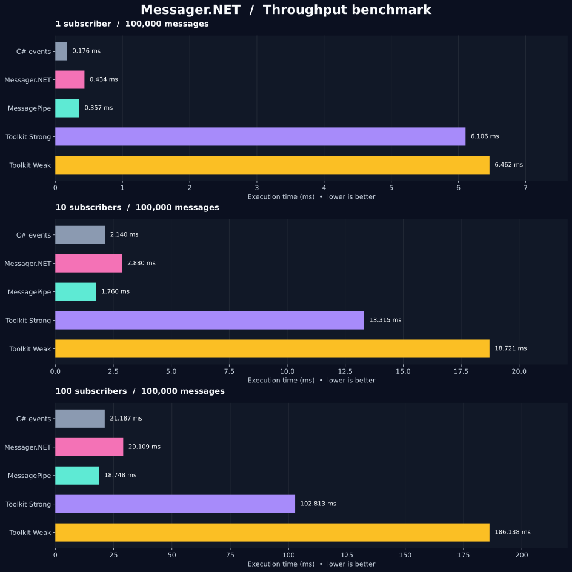

# Messager.NET

[](https://www.nuget.org/packages/Messager.NET)
[](https://www.nuget.org/packages/Messager.NET)
[](https://github.com/NovoDwarf/Messager.NET/actions/workflows/ci.yml)
[](LICENSE)

A messaging library for .NET. It provides typed pub/sub, request contracts and an in-memory background queue.

> [!WARNING]
> This is an educational project and is still under development. It may contain bugs and is not production-ready.

Targets .NET 10 and .NET 11.

## Features

- Synchronous and asynchronous pub/sub, with optional keys.
- Strong and weak subscriptions with explicit lifetime control.
- Request contracts with synchronous and asynchronous handlers.
- A bounded background queue for processing messages in order.
- Integrations with Microsoft DI, Autofac and Pure.DI.

## Installation

Install the runtime package:

```shell
dotnet add package Messager.NET
```

Use `Messager.NET.Core` if a project only needs the contracts. For dependency injection, add the integration package you
need: `Messager.NET.Microsoft.DependencyInjection`, `Messager.NET.Autofac` or `Messager.NET.PureDI`.

## Pub/sub

Create an `Exchange`, subscribe to a message and send it:

```csharp
using Messager.NET.Entities;

var exchange = new Exchange();
var receiver = exchange.GetReceiver<string>();
var sender = exchange.GetSender<string>();

using var subscription = receiver.Subscribe(message => Console.WriteLine(message));
sender.Send("Hello");
```

Each subscription has its own handle. Dispose it when the handler is no longer needed. Subscriptions keep their
callback targets alive by default; pass `SubscriptionReference.Weak` to allow them to be collected.

For keyed messages, use `GetKeyedReceiver<TKey, TEvent>()` and `GetKeyedSender<TKey, TEvent>()`. Async handlers use
`GetAsyncReceiver<TEvent>()` and `GetAsyncSender<TEvent>()`; keyed async variants are also available.

See [subscription and queue behavior](Docs/Messaging-Behavior.md) for lifetime, delivery and error-handling details.

## Dependency injection

For Microsoft DI, install `Messager.NET.Microsoft.DependencyInjection` and register the services:

```csharp
using Messager.NET.Microsoft.DependencyInjection.Extensions;

services.AddMessager();
```

For Autofac, install `Messager.NET.Autofac` and call `builder.AddMessager()` from
`Messager.NET.Autofac.Extensions`. Both integrations use a shared `Exchange` per container. Logging is disabled by
default and can be enabled through `options.EnableLogging`.

The [Pure.DI integration](Sources/Messager.NET.PureDI/README.md) provides pub/sub bindings and has its own setup and
limitations.

## Requests and queues

Request interfaces describe handlers that return a result. Microsoft DI and Autofac can register handlers from an
assembly, after which they can be injected directly or resolved through `IRequestFactory` and `IAsyncRequestFactory`.
Request type arguments put the output before the input. Pure.DI requires explicit handler bindings and does not provide
the request factories.

`MessageQueue<TMessage>` is a separate bounded queue with one background worker. It does not change how `Exchange`
dispatches messages. See the [queue example](Examples/Messager.NET.Queued) and the
[behavior guide](Docs/Messaging-Behavior.md) for ownership, shutdown and failure semantics.

## Examples

The [Examples](Examples) directory contains synchronous, asynchronous, keyed, request, queue and Pure.DI examples.
To run one:

```shell
dotnet run --project Examples/Messager.NET.Simple -f net10.0
```

## Tests and benchmarks

```shell
dotnet test Messager.NET.slnx -c Release -p:GeneratePackageOnBuild=false
dotnet run --project Sources/Messager.NET.Benchmarks -c Release -f net10.0
```



## Thanks

Inspired by [MessagePipe](https://github.com/Cysharp/MessagePipe) by [Cysharp](https://github.com/Cysharp).

## License

[MIT](LICENSE)
